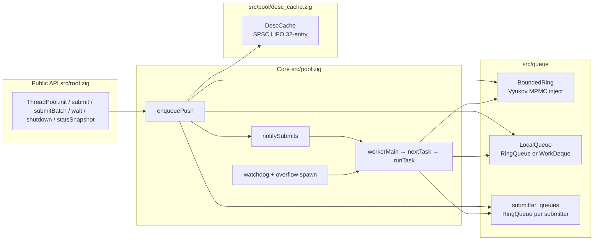
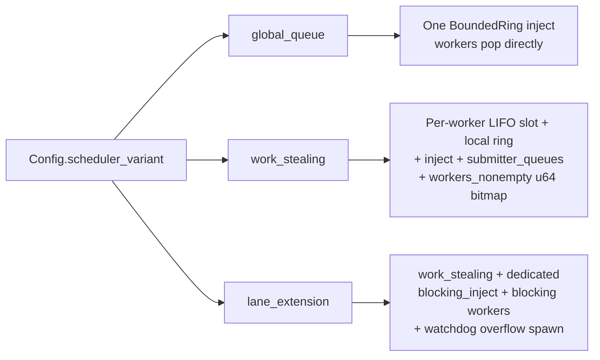

# thread-pool

`thread-pool` is a bounded Zig 0.16.0 thread-pool library built for the
`devnw/zig` ecosystem. One public API, three scheduler variants behind
it, and a hardened performance / security track-record documented in
`docs/`.

- **Bounded by construction.** Fixed descriptor pool, fixed worker cap,
  bounded per-worker queues, bounded inject queue.
- **Lock-free hot paths.** Chase-Lev / SPMC ring / Vyukov MPMC queues;
  SPSC LIFO descriptor caches; single-owner LIFO slot.
- **Two scheduler defaults + a blocking-lane extension.** `global_queue`,
  `work_stealing`, `lane_extension` — picked via one `Config` field.
- **Runtime parity harness.** Direct side-by-side benchmarks against
  vendored Tokio and Go source trees.
- **Memory-safety hardened.** 1 Critical + 2 High AppSec findings fixed;
  TSan + fuzz clean; see
  [`docs/performance/appsec-fixes-2026-04-15/FINAL.md`](docs/performance/appsec-fixes-2026-04-15/FINAL.md).

## Status

| Field | Value |
|---|---|
| Zig target | `0.16.0` |
| Scheduler variants | `global_queue`, `work_stealing`, `lane_extension` |
| Default scheduler | `global_queue` |
| Tests passing | 84 / 85 (1 skipped, runtime-safety-gated) |
| TSan baseline | Zero warnings across unit + integration + stress |
| Fuzz baseline | Clean across 32–256 ops × ≥100 iterations |
| Current HEAD | see `git log -1` |

## Getting Started

```zig
const std = @import("std");
const thread_pool = @import("thread_pool");

fn task(ctx: *anyopaque, runtime: *thread_pool.TaskContext) void {
    _ = ctx;
    _ = runtime;
}

pub fn main() !void {
    var gpa = std.heap.GeneralPurposeAllocator(.{}){};
    defer _ = gpa.deinit();

    var pool = try thread_pool.ThreadPool.init(gpa.allocator(), .{
        .min_threads = 2,
        .max_threads = 4,
        .queue_capacity = 1024,
        .local_queue_capacity = 128,
        .scheduler_variant = .work_stealing,
    });
    defer pool.deinit();

    var wg = pool.waitGroup();
    _ = try pool.submit(task, undefined, .{ .wait_group = &wg });
    wg.wait();
}
```

See [docs/getting-started.md](docs/getting-started.md) for the full
walkthrough, [docs/api-reference.md](docs/api-reference.md) for every
public symbol, and [docs/examples.md](docs/examples.md) for batch
submission, blocking lanes, and cancellation.

## Architecture At A Glance



Full-depth algorithms reference: [docs/ALGORITHMS.md](docs/ALGORITHMS.md)
includes mermaid diagrams for each pipeline (task submission, worker
loop, descriptor lifecycle, DescCache flow, Chase-Lev deque, Vyukov
MPMC, wake coalescing, lane routing, shutdown).

## Scheduler Variants



| Variant | When to use |
|---|---|
| `global_queue` | Simplest correctness baseline; low per-worker overhead. |
| `work_stealing` | General-purpose; best throughput in most mixed workloads. |
| `lane_extension` | Mixing long-running (blocking) and short-latency tasks. |

## Performance Snapshot

Same-host `bench-runtime-compare` at HEAD = `2c99e2b` (2026-04-17, Linux
x86_64, 56 workers, 6 retained samples after 1 warmup discard). Full
tables and methodology in [docs/BENCHMARKS.md](docs/BENCHMARKS.md).

### Throughput (ops/sec)

| Scenario | Zig thread-pool | Tokio | Go | Zig vs Go |
|---|---:|---:|---:|---:|
| `flood_1m` | 860,073 | 343,795 | 679,626 | **1.27x ahead** |
| `contended_spawn_8x` | 1,141,570 | 607,149 | 3,042,676 | 2.66x behind |
| `cpu_work_10us` | 1,070,750 | 449,018 | 554,179 | **1.93x ahead** |
| `cpu_work_100us` | 480,783 | 309,121 | 416,573 | **1.15x ahead** |
| `contended_cpu_10us` | 1,244,836 | 621,083 | 1,783,701 | 1.43x behind |
| `nested_fanout_4x` | 1,127,801 | 1,392,766 | 2,954,402 | 2.62x behind |
| `burst_drain_burst` | 160,994 | 142,510 | 141,912 | **1.13x ahead** |
| `mixed_fast_slow` | 258,541 | 231,506 | 252,541 | **1.02x ahead** |

**Wins:** 5/8 vs Go, 7/8 vs Tokio. See
[docs/RUNTIME_COMPARISON.md](docs/RUNTIME_COMPARISON.md) for latency
tables and per-scenario analysis.

### Scheduling Techniques Wired In

| Feature | Where | Measured gain |
|---|---|---|
| Wake coalescing (`wake_coalesce_batch=32`) | `notifySubmits` → `scanAndWake` | `flood_1m +183%` |
| Per-submitter SPMC queues (`registerSubmitter`) | `enqueuePush` fallback | `contended_spawn_8x +17.2%` |
| Per-worker + per-submitter `DescCache` (SPSC LIFO 32) | hot-path descriptor acquire | `nested_fanout_4x +81.26%` paired |
| `workers_nonempty` u64 steal bitmap | `nextTask` victim selection | `contended_spawn_8x +17%` |
| Inject `popMany` batched drain | `tryDrainLaneForWorker` | `flood_1m_batched +14%` |
| Gen-tagged queue entries (u32→u64) | `runTask` stale-entry filter | 20/20 reorder+sentinel stress |
| Comptime elision (`-Dsingle-pool`, `-Dtimestamp-mode`, `-Dscheduler-variant`) | `build.zig` | 6–17% on single-pool hosts |

## Build & Test

```bash
make build
make test              # unit + integration
make test-stress
make ci                # everything
```

Or directly with Zig:

```bash
zig build build
zig build test --summary all
zig build test-integration --summary all
zig build test-stress --summary all
zig build test-all --summary all
```

ThreadSanitizer sweep:

```bash
zig build test-all -Dtsan    # stress suite auto-downgrades to Debug under TSan
zig build fuzz -Dtsan
```

## Benchmark Commands

```bash
# CI-safe suite
zig build bench -- --output benchmarks/results/latest.json

# Scale suite (longer scenarios)
zig build scale-bench -- --output benchmarks/results/scale-latest.json

# Zig-only latency suite (cpu_work, contended, nested, burst, mixed,
# lane isolation)
zig build bench-realistic -Doptimize=ReleaseFast

# Direct comparison against vendored Tokio and Go
git submodule update --init --recursive
zig build bench-runtime-compare -Doptimize=ReleaseFast -- \
  --output benchmarks/results/runtime-comparison-latest.json

# Compare two baselines
zig build compare-bench -- \
  --baseline benchmarks/results/baseline.json \
  --current benchmarks/results/latest.json
```

The comparison binary matches rows by scenario, scheduler, worker count,
and submitter count, so the output is directly diffable.

## Configuration Highlights

```zig
// Most-used config knobs (see src/types.zig for the full set).
.scheduler_variant  = .work_stealing,  // .global_queue / .work_stealing / .lane_extension
.min_threads        = 2,               // lower bound on spawned workers
.max_threads        = 8,               // hard cap (≤ 64, bounded by workers_nonempty u64)
.queue_capacity     = 1024,            // inject queue + bounded descriptor pool
.local_queue_capacity = 256,           // per-worker ring capacity (power of two)
.queue_kind         = .ring,           // .ring (default) / .chase_lev
.inject_batch_size  = 32,              // popMany drain batch
.steal_batch_size   = 16,              // max entries per stealHalf call
.wake_coalesce_batch = 32,             // wake scan + signal every N submits
.max_submitter_queues = 0,             // >0 enables registerSubmitter API
.allow_blocking_lane = false,          // enable blocking-lane routing
.blocking_workers   = 0,               // workers reserved for .blocking lane
.cpu_helps_blocking = false,           // default workers help blocking lane (L3)
.watchdog_interval_ns = 0,             // L4 stall detection (0 disables)
.max_overflow_workers = 0,             // L4b elastic spawn cap
.timestamp_mode     = .full,           // .disabled / .completion_only / .full
```

Build-time comptime flags:

| Flag | Default | Effect |
|---|---|---|
| `-Dsingle-pool=true` | `false` | Elide per-pool TLS identity check. **UNSAFE** with >1 pool per process — restores the pre-F-001 OOB hazard. +6–17% on submit-heavy scenarios. |
| `-Dtimestamp-mode=<m>` | runtime | Pin `Config.timestamp_mode` at build time. Always safe. |
| `-Dscheduler-variant=<v>` | runtime | Pin `Config.scheduler_variant` at build time. Always safe. |
| `-Dtsan` | `false` | Enable ThreadSanitizer; auto-downgrades stress suite to Debug. |

## Public API

Stable surface from [src/root.zig](src/root.zig):

- `ThreadPool.init(allocator, config) !ThreadPool`
- `ThreadPool.deinit()`
- `ThreadPool.submit(task_fn, ctx, options) !TaskHandle`
- `ThreadPool.trySubmit(task_fn, ctx, options) !TaskHandle`
- `ThreadPool.submitBatch(tasks, options) !SubmitBatchResult`
- `ThreadPool.wait(handle) !void`
- `ThreadPool.waitGroup() WaitGroup`
- `ThreadPool.shutdown(mode, timeout_ns) !void` — `.drain` / `.cancel_pending`
- `ThreadPool.statsSnapshot() Stats`
- `ThreadPool.purgeWorkerCaches() !void`
- `ThreadPool.registerSubmitter() !usize` / `releaseSubmitter(idx)`

Exported queue primitives for low-level experimentation:

- `thread_pool.BoundedRing(T)` — Vyukov MPMC
- `thread_pool.RingQueue(T)` — SPMC
- `thread_pool.WorkDeque(T)` — Chase-Lev
- `thread_pool.DescCache` — SPSC LIFO 32

## Documentation Map

### Start here

- [Getting Started](docs/getting-started.md)
- [API Reference](docs/api-reference.md)
- [Examples](docs/examples.md)
- [FAQ](docs/faq.md)

### Deep dives

- [Architecture](docs/architecture.md) — component layout + ownership
- [Design](docs/DESIGN.md) — rationale, queue design, memory model
- [Algorithms](docs/ALGORITHMS.md) — mermaid diagrams for every pipeline
- [Benchmarks](docs/BENCHMARKS.md) — scenario matrix, A/B protocol
- [Runtime Comparison](docs/RUNTIME_COMPARISON.md) — Zig vs Tokio vs Go
- [Testing](docs/TESTING.md) — validation matrix, TSan, fuzz
- [Scheduler Decision](docs/SCHEDULER_DECISION.md)
- [Performance Tracking](docs/PERFORMANCE_TRACKING.md)

### Security

- [AppSec Review (2026-04-15)](docs/APPSEC_REVIEW_2026-04-15_src.md)
- [AppSec Remediation](docs/performance/appsec-fixes-2026-04-15/FINAL.md)
- [TSan Baseline](docs/performance/appsec-fixes-2026-04-15/TSAN-findings.md)
- [SEC-018 — `wait()` idempotency](docs/security/SEC-018.md)
- [REV-001 — `task_fn` panic contract](docs/security/REV-001.md)

### Performance archive

- [2026-04-17 Go-gap round 2 (FAILED)](docs/performance/2026-04-17-go-gap-round2/FINAL.md) — closed planes reference
- [2026-04-16 Go-gap contended (DescCache)](docs/performance/2026-04-16-go-gap-contended/FINAL.md)
- [2026-04-15 AppSec remediation perf ledger](docs/performance/appsec-fixes-2026-04-15/README.md)
- [2026-04-15 Direct runtime comparison](docs/performance/2026-04-15-runtime-comparison/README.md)

## License

Apache-2.0. See [LICENSE](LICENSE).
