# Algorithms Reference

This document consolidates the core algorithms that drive `thread-pool`,
with mermaid diagrams for each pipeline and pseudocode tied back to the
source files. Use it as the entry point when reasoning about scheduling,
queueing, descriptor lifecycle, or wake behaviour.

All algorithm names in headings map directly to a file or function under
`src/`; line numbers intentionally omitted so the document does not rot
with refactors — search for the symbol name instead.

## Table Of Contents

- [Top-Level Task Pipeline](#top-level-task-pipeline)
- [Descriptor Lifecycle](#descriptor-lifecycle)
- [DescCache (SPSC LIFO)](#desccache-spsc-lifo)
- [Chase-Lev Work-Stealing Deque](#chase-lev-work-stealing-deque)
- [RingQueue (SPMC)](#ringqueue-spmc)
- [BoundedRing (Vyukov MPMC)](#boundedring-vyukov-mpmc)
- [Worker Scheduling Loop](#worker-scheduling-loop)
- [Wake Coalescing + Parked-Worker Scan](#wake-coalescing--parked-worker-scan)
- [Lane Routing And Rebalancing](#lane-routing-and-rebalancing)
- [Watchdog + Overflow Spawn](#watchdog--overflow-spawn)
- [Shutdown](#shutdown)
- [Comptime Elision Hooks](#comptime-elision-hooks)

---

## Top-Level Task Pipeline

End-to-end flow for a single `submit()` / `submitBatch()` call, from user
thread through the pool into an executing worker.

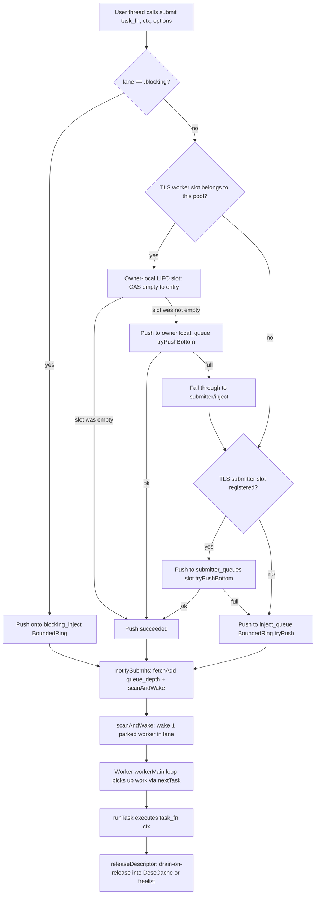

Key design points:

1. **LIFO slot is owner-only.** Only the worker thread that owns a given
   worker slot ever writes to `lifo_slot`. Stealers never touch it. This
   makes the fast-path submit a single release store when the slot is
   empty.
2. **Per-submitter queues are SPMC.** Only the submitter thread that
   registered for slot `i` pushes to `submitter_queues[i]`; any worker
   may steal from head.
3. **`inject_queue` is MPMC.** It is the fallback when both LIFO and
   local paths miss, and the ground truth for `global_queue` variant.
4. **Wake coalescing:** notify side wakes at most one parked worker per
   batch of `wake_coalesce_batch` submits. Between flushes, parked
   workers re-park bail via the seq-cst `queued_tasks` handshake.

Reference: `src/pool.zig::enqueuePush`, `src/pool.zig::enqueueTask`,
`src/pool.zig::notifySubmits`.

---

## Descriptor Lifecycle

Each submitted task owns one `TaskDescriptor` from a bounded preallocated
array (`queue_capacity` entries). The state machine below is enforced by
a CAS-guarded `descriptor.state` field plus a `generation` tag that
invalidates stale handles.

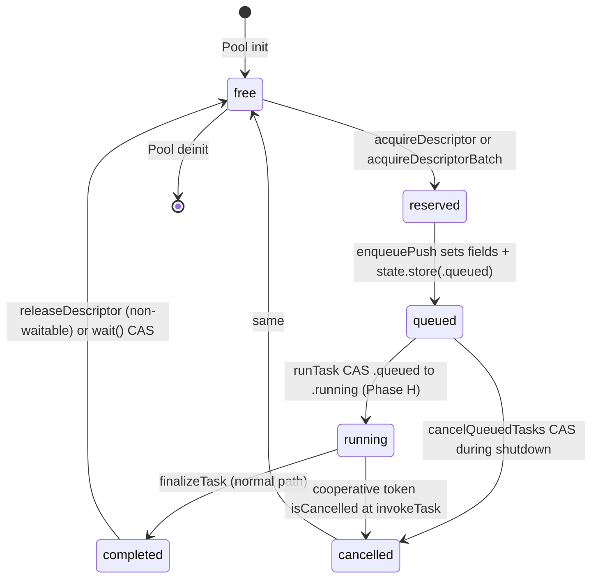

Invariants:

- **Generation tag in queue entries.** `QueueEntry = {u32 gen, u32 idx}`.
  `runTask` filters entries whose gen doesn't match the descriptor's
  current generation — closes double-dispatch on recycled slots.
- **CAS-on-release (SEC-018).** `releaseDescriptor` uses
  `state.cmpxchgStrong(expected, .free)` so concurrent `wait()` calls
  cannot double-push onto the freelist.
- **Active invariant.** `task_desc_live == 0` post-shutdown; fuzz harness
  asserts this every iteration.
- **Panic contract (REV-001).** `task_fn` must not panic — Zig panics are
  non-catchable; the pool cannot self-heal from a panicked task.

Reference: `src/pool.zig::runTask`, `src/pool.zig::finalizeTask`,
`src/pool.zig::releaseDescriptor`, `src/pool.zig::acquireDescriptor`.

---

## DescCache (SPSC LIFO)

The 32-entry LIFO descriptor cache that gates the global freelist on the
hot submit path. One instance per submitter slot and one per worker.
Both owner classes are single-writer / single-reader by construction —
no atomic ops in the fast path.

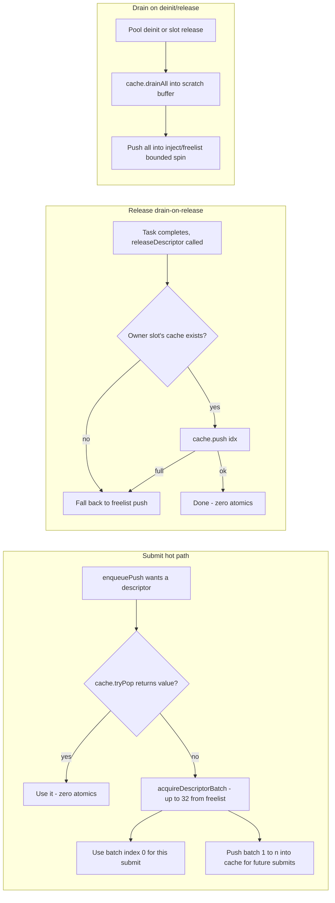

Why it matters:

- Removes per-submit coherence traffic on the global `task_desc_free`
  head CAS. On `nested_fanout_4x` this lifted worker-context submits
  by `+81.26%` paired vs the pre-`DescCache` baseline.
- Bounded 32 entries per slot — full drain fits in a single 128-byte
  copy loop, so drain-on-release is cheap.
- Drain-on-release preserves `task_desc_live == 0` at shutdown: the slot
  being released drains its cache to the inject/freelist **before** the
  `free_mask` CAS publishes the slot as free.

Reference: `src/pool/desc_cache.zig`, `src/pool.zig::acquireDescriptorBatch`,
`src/pool.zig::drainWorkerDescCaches`.

---

## Chase-Lev Work-Stealing Deque

`WorkDeque` is the classic lock-free Chase-Lev deque. It remains exported
as an optional `queue_kind = .chase_lev` and for experimentation; the
default owner-local queue is `RingQueue` (see next section).

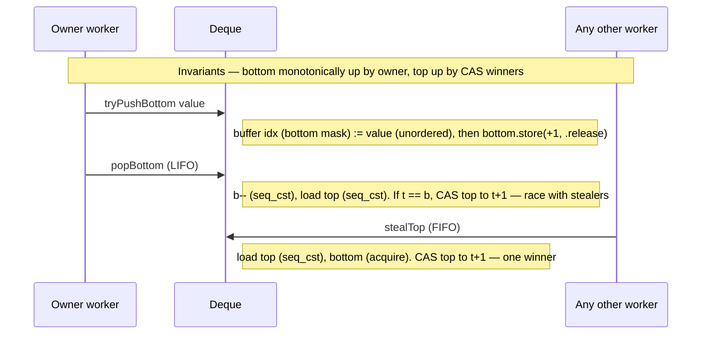

Properties:

- **Owner-only** for `tryPushBottom` and `popBottom`.
- **Any thread** for `stealTop`; contested slots resolve via a strong CAS
  on `top`. A losing stealer returns null without retrying so the caller
  can pick another victim.
- **Power-of-two buffer size**, masked with `size - 1` for wrap.
- **No batch steal** — Chase-Lev's linearization proof doesn't generalize
  to batched takes; for that we use the `RingQueue` variant.

Reference: `src/queue/work_deque.zig`.

---

## RingQueue (SPMC)

The default owner-local queue, modelled on Tokio's
`runtime/scheduler/multi_thread/queue.rs` and Go's `runq*` in
`runtime/proc.go`. Single producer (owner) writes tail; any thread may
`stealHalf` in batches from head.

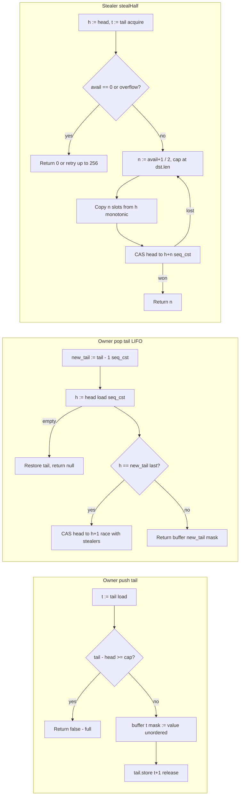

Correctness sketch:

- Owner is the sole writer of `tail` and of slot contents.
- Stealers synchronise with each other via seq-cst CAS on `head`, which
  is the linearization point of a batch.
- Owner never writes slot `i` while `head <= i < tail`, so stealer reads
  between load-head and CAS-head are safe — worst case another stealer
  wins the CAS and the loser's reads are discarded.
- Owner-vs-stealer race on the last element: seq-cst fence on tail then
  re-read head, same pattern as Chase-Lev's `popBottom`.

Reference: `src/queue/ring_queue.zig`.

---

## BoundedRing (Vyukov MPMC)

The shared inject queue `inject_queue` uses a Vyukov-style bounded MPMC
ring. Per-slot `sequence` word encodes both "producer turn" and
"consumer turn" so push and pop interleave without locks.

```mermaid
flowchart TB
    subgraph tryPush[tryPush value]
        P1[tail := tail load]
        P1 --> P2[slot := buffer tail mask]
        P2 --> P3[seq := slot.sequence load acquire]
        P3 --> P4{diff := seq - tail}
        P4 -- 0 --> P5[CAS tail to tail+1 monotonic]
        P5 -- won --> P6[slot.value := value]
        P6 --> P7[slot.sequence.store tail+1 release]
        P5 -- lost --> P1
        P4 -- "<0" --> P8[Full, return false]
        P4 -- ">0" --> P1
    end
    subgraph pop[pop returns value?]
        G1[head := head load]
        G1 --> G2[slot := buffer head mask]
        G2 --> G3[seq := slot.sequence load acquire]
        G3 --> G4{diff := seq - head+1}
        G4 -- 0 --> G5[CAS head to head+1 monotonic]
        G5 -- won --> G6[value := slot.value]
        G6 --> G7[slot.sequence.store head+cap release]
        G5 -- lost --> G1
        G4 -- "<0" --> G8[Empty, return null]
        G4 -- ">0" --> G1
    end
    subgraph popMany[popMany buf]
        M1[Reserve up to buf.len in one head CAS]
        M1 --> M2[Per slot: spin until sequence == head+i+1]
        M2 --> M3[Copy value, republish sequence += cap]
    end
```

`popMany` is the **inject-drain fast path** — a single strong CAS reserves
up to N entries (default: `inject_batch_size`, up to 32) so worker
drains amortise head-CAS traffic. On `flood_1m_batched` this cut head-CAS
rate by the drain-batch factor (median `+14%` at drain=32 in the 2026-04-14
inject-head contention audit).

Reference: `src/queue/bounded_ring.zig`.

---

## Worker Scheduling Loop

Each worker runs `workerMain(self, worker_index)` in a tight loop that
calls `nextTask` to find work, `runTask` to execute it, or `idle` to park
when nothing is available.

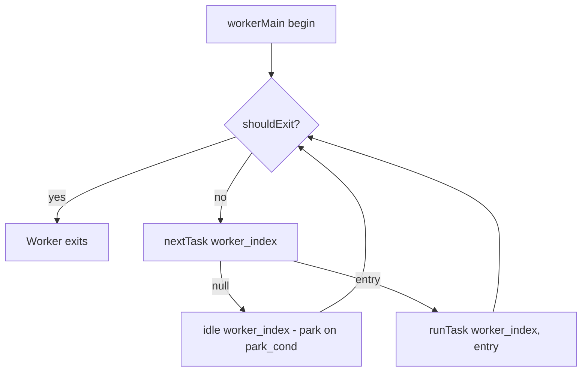

`nextTask` drain order (default work-stealing variant):

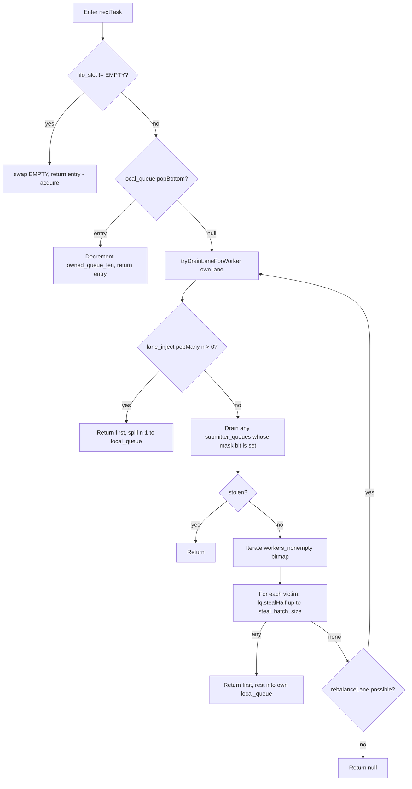

Key optimisations captured in this diagram:

1. **`workers_nonempty` bitmap** — a `u64` where bit `i` is set when
   worker `i`'s `owned_queue_len > 0`. Steal pass iterates set bits
   instead of probing 55 victim queues' heads. Landed at e533955;
   `+17%` contended_spawn_8x clean A/B.
2. **Non-empty local reconciliation** — when `popBottom` returns null
   with `owned_queue_len > 0`, stealers drained it, so reconcile to 0
   and clear the bitmap bit.
3. **Inject drain → local spill** — `popMany` reserves up to
   `inject_batch_size` in one head CAS, then spills the tail into the
   worker's local deque so each inject drain satisfies many submits.
4. **Cross-lane rebalance (L3)** — blocking workers always help the
   default lane when own lane is empty; default workers help blocking
   only under `cpu_helps_blocking`.

Reference: `src/pool.zig::workerMain`, `src/pool.zig::nextTask`,
`src/pool.zig::tryDrainLaneForWorker`, `src/pool.zig::rebalanceLane`.

---

## Wake Coalescing + Parked-Worker Scan

`notifySubmits` batches the park handshake + futex wake, and `scanAndWake`
probes at most one parked worker per notify.

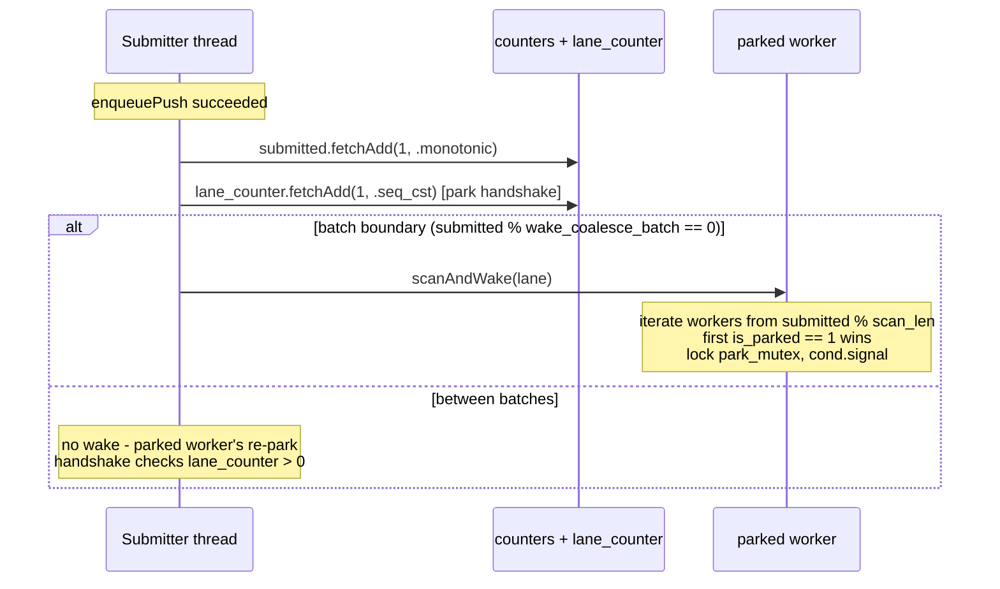

Why it works:

- **SC fetchAdd** on `lane_counter` plus SC read by a parking worker form
  an SC total order. A worker that is about to park first does an SC load
  of `lane_counter`; if it sees `> 0`, it bails back to `nextTask`.
- **Wake at most one** per notify — a wake-up-to-`count` variant regressed
  `flood_1m_batched` `~50%` due to thundering-herd on the inject head
  cacheline (measured in 2026-04-14 cascading-wake plan, memoised as a
  closed plane).
- **Scan hint from `submitted % scan_len`** rotates the first-probed
  worker across submits so consecutive waves don't always hit worker 0.

Reference: `src/pool.zig::notifySubmits`, `src/pool.zig::scanAndWake`.

---

## Lane Routing And Rebalancing

The `lane_extension` scheduler adds a dedicated blocking lane with its
own inject queue, worker range, and rebalance rules. Default lane
workers own slot `[blocking_workers, max_threads)`; blocking workers
own `[0, blocking_workers)`.

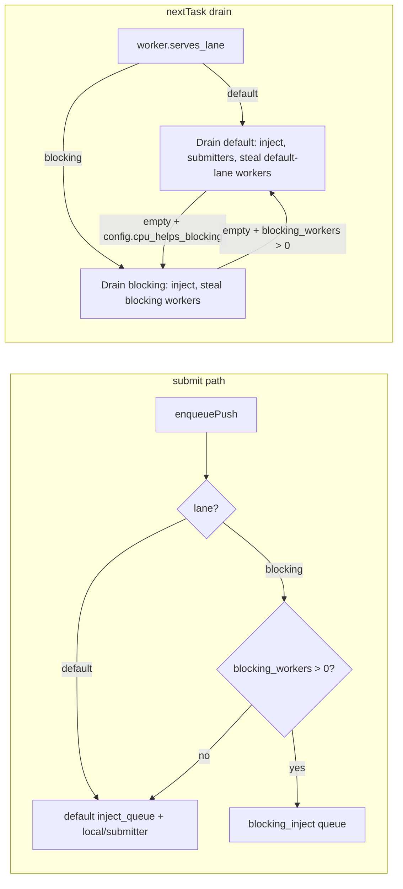

Slice history (L1 → L4) lives in
`docs/superpowers/specs/2026-04-15-lane-extension-scheduler-design.md`.
L3 added cross-lane rebalance; L4 added watchdog observability and
overflow spawn/retire.

Reference: `src/pool.zig::tryDrainLaneForWorker`,
`src/pool.zig::rebalanceLane`, `src/pool.zig::laneInjectQueue`,
`src/pool.zig::laneMask`.

---

## Watchdog + Overflow Spawn

Optional watchdog thread that ticks every `watchdog_interval_ns` and
spawns one overflow worker per tick when it detects a default-lane stall
longer than `blocking_promotion_timeout_ns`.

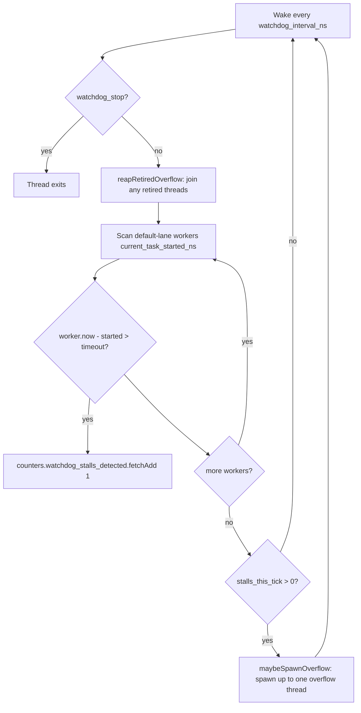

Overflow workers retire themselves after `2 * watchdog_interval_ns` of
idleness; the watchdog then joins them on its next tick. Both the
spawn and retire paths are zero-cost when
`Config.max_overflow_workers == 0`.

Reference: `src/pool.zig::watchdogMain`,
`src/pool.zig::maybeSpawnOverflow`, `src/pool.zig::overflowWorkerMain`.

---

## Shutdown

Two modes:

- `drain` — reject new submissions, let queued + running work finish,
  join workers, release memory.
- `cancel_pending` — reject new submissions, cancel queued tasks (CAS
  `.queued → .cancelled`), let running tasks finish.

```mermaid
flowchart LR
    Start[shutdown mode, timeout] --> Flag[state := shutting_down - reject future submits]
    Flag --> Mode{mode?}
    Mode -- drain --> Wait[Wait for queued_tasks + active_tasks == 0]
    Mode -- cancel_pending --> Cancel[cancelQueuedTasks - CAS queued to cancelled for every queued descriptor]
    Cancel --> Wait
    Wait --> Stop[watchdog_stop := true, wake watchdog]
    Stop --> Wake[Broadcast park_cond across all workers]
    Wake --> Join[Join all worker threads + watchdog]
    Join --> Drain2[drainWorkerDescCaches: flush per-worker DescCache into freelist]
    Drain2 --> DrainSub[drainSubmitterDescCaches + submitter_queues]
    DrainSub --> Verify[Assert task_desc_live == 0]
    Verify --> Free[deinit: free all owned allocations, release queues]
```

Key subtleties:

- `task_desc_live == 0` is the post-shutdown invariant; DescCache drain
  order matters (see [DescCache](#desccache-spsc-lifo)).
- `shutdown(.drain)` with `backpressure = .block` is fine — the submit
  path sees `shutting_down` and returns `error.PoolShutdown` before it
  can block on a full queue.
- Fuzz harness asserts shutdown terminates within 5 seconds across
  32–256 random ops per iteration.

Reference: `src/pool.zig::shutdown`, `src/pool.zig::cancelQueuedTasks`,
`src/pool.zig::joinAllWorkers`, `src/pool.zig::drainWorkerDescCaches`.

---

## Comptime Elision Hooks

Build-time specialisation points. All `fold to a constant` when
`-D<flag>` is passed; unused branches drop out of the ReleaseFast binary
and its associated coherence cost disappears.

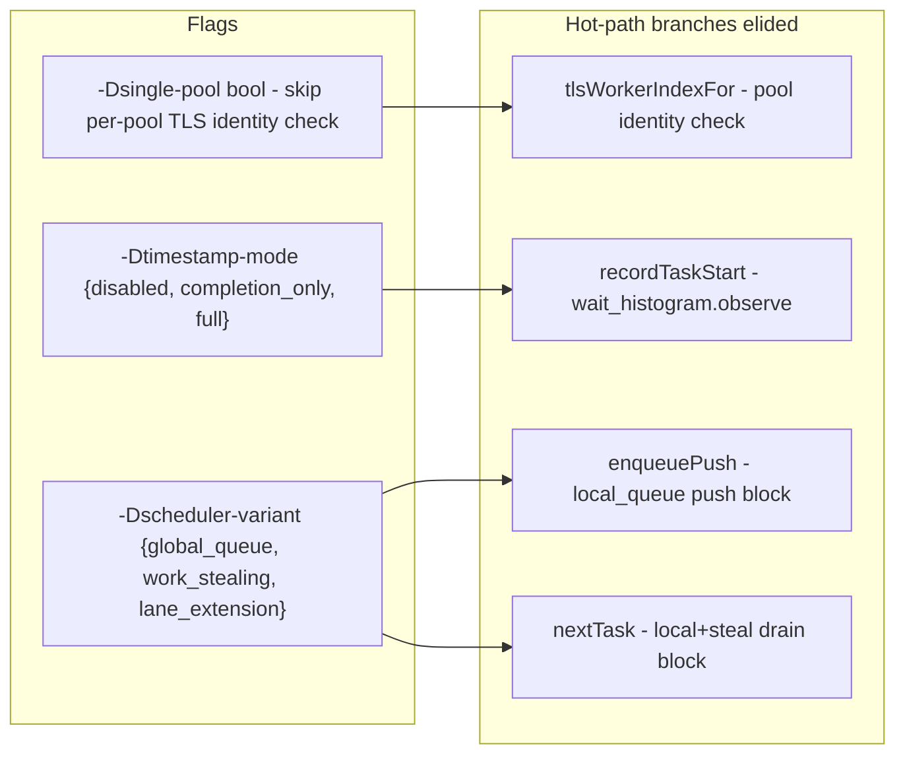

**Safety notes:**

- `-Dsingle-pool=true` **restores** the pre-F-001 cross-pool OOB hazard
  for the index-within-bounds case. Use only in processes that host
  exactly one `ThreadPool`. Measured gain: 6–17% on
  `contended_spawn_8x`, `cpu_work_100us`, `mixed_fast_slow`.
- `-Dtimestamp-mode=disabled` is always safe; it elides histogram writes
  and makes wait/exec latency fields always report zero.
- `-Dscheduler-variant=<v>` is always safe; it pins
  `Config.scheduler_variant` at build time and drops the alternative
  scheduler's drain/submit branches.

Reference: `build.zig`, `src/pool.zig::usesLocalQueues`,
`src/pool.zig::timestampsEnabled`, `src/pool.zig::single_pool_mode`.

---

## Further Reading

- [DESIGN.md](DESIGN.md) — higher-level design rationale and public API
  surface.
- [architecture.md](architecture.md) — component layout and ownership.
- [BENCHMARKS.md](BENCHMARKS.md) — per-scenario methodology and current
  numbers.
- [RUNTIME_COMPARISON.md](RUNTIME_COMPARISON.md) — Zig vs Tokio vs Go
  same-host comparison.
- [PERFORMANCE_TRACKING.md](PERFORMANCE_TRACKING.md) — long-form
  per-phase deltas and historical rationale.
- `docs/performance/2026-04-16-go-gap-contended/FINAL.md` — DescCache
  landing post-mortem.
- `docs/performance/2026-04-17-go-gap-round2/FINAL.md` — closed-plane
  record of lifo-rotate + batched-submitBatch attempts.
