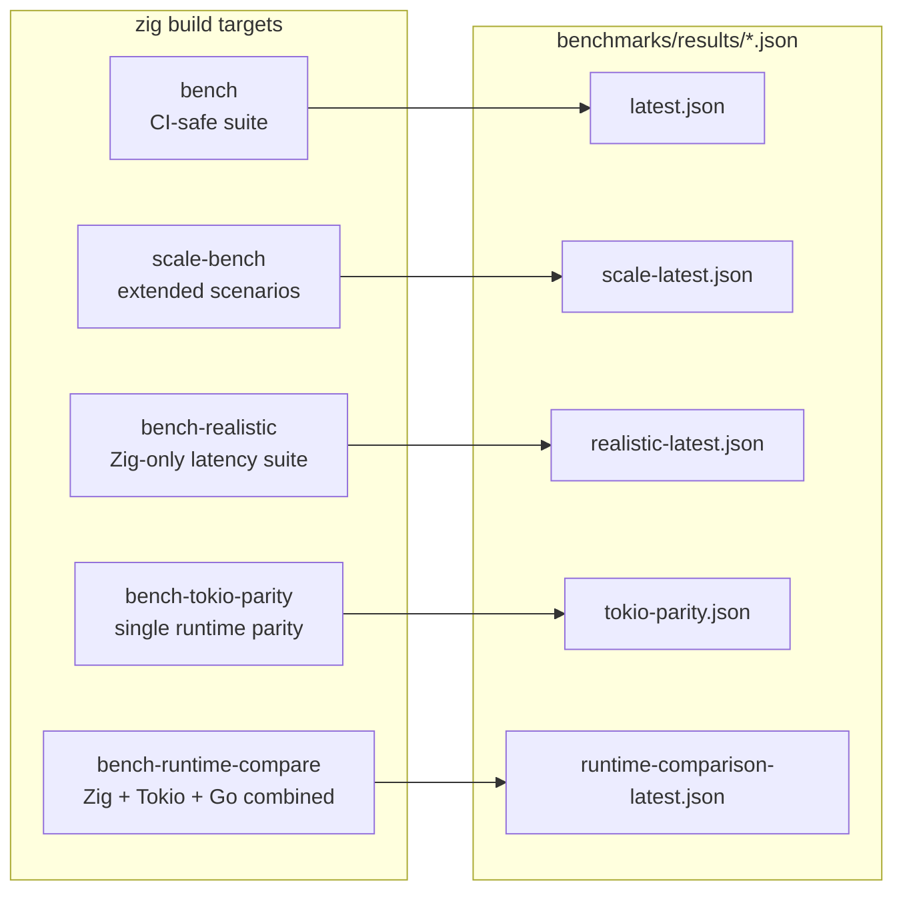
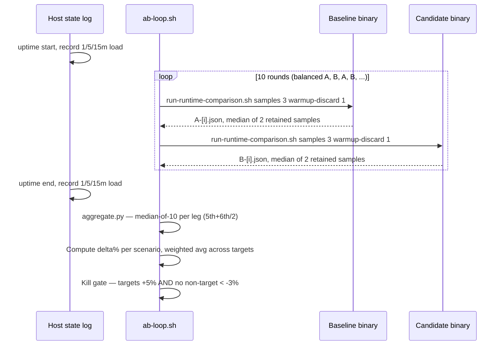
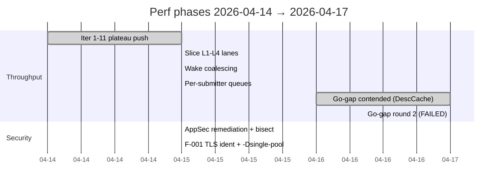

# Benchmarks

This page documents the full benchmark matrix, measurement protocol, and
the current snapshot. See [RUNTIME_COMPARISON.md](RUNTIME_COMPARISON.md)
for the Zig-vs-Tokio-vs-Go interpretation and
[PERFORMANCE_TRACKING.md](PERFORMANCE_TRACKING.md) for the full phase-by
-phase history.

## Benchmark Targets



## Measurement Protocol

All perf-relevant runs follow the **paired same-session A/B** protocol
established by the project measurement rules:



Parameters:

- **n = 10 rounds**, each retaining 2 samples after 1 warmup-discard →
  20 raw Zig samples per leg per scenario, reduced to 10 per-leg medians.
- **Median-of-10** = mean of sorted ascending entries 5 and 6.
- **Kill gate** (for targeted plans):
  - Weighted-avg Δ across target scenarios ≥ +5%, AND
  - No non-target scenario Δ < −3%.
- **20x ReleaseFast stress gate** required on any commit touching the
  submit / wake / queue / scheduler paths: `zig build test-stress` ×20,
  all passing.

## Scenario Matrix

The shared scenario contract across all three runtimes
(`flood_1m`, `contended_spawn_8x`, `cpu_work_10us`, `cpu_work_100us`,
`contended_cpu_10us`, `nested_fanout_4x`, `burst_drain_burst`,
`mixed_fast_slow`) and Zig-only lane isolation lives in
`benchmarks/realistic_scenarios.zig`.

| Scenario | Tasks | Submitters | Task body | Intent |
|---|---:|---:|---|---|
| `flood_1m` | 1,000,000 | 1 | noop (atomic increment) | submit-path throughput ceiling |
| `contended_spawn_8x` | 100,000 | 8 | noop | multi-producer contention on submit |
| `cpu_work_10us` | 10,000 | 1 | 10 µs busy loop | scheduling overhead under real CPU work |
| `cpu_work_100us` | 2,000 | 1 | 100 µs busy loop | medium-task dispatch latency |
| `contended_cpu_10us` | 10,000 | 4 | 10 µs busy loop | contended submit + real work |
| `nested_fanout_4x` | 10,000 | 1 | parent spawns 4 children | worker-context recursive submit |
| `burst_drain_burst` | 4,000 | 1 | 50 µs busy loop, 10 ms gap | wake-from-idle recovery |
| `mixed_fast_slow` | 5,000 | 1 | 80% noop, 20% 1 ms busy loop | lane fairness + tail latency |

All realistic scenarios use **busy loops**, not `sleep()`, so they
measure scheduling overhead under CPU pressure rather than timer
resolution.

## Current Snapshot

Run date: **2026-04-17**
HEAD: `2c99e2b` (code-identical to `a666ec3`, Go-gap round 1 FINAL)
Host: Linux x86_64, 2-socket / 1-NUMA-node / 56 logical cores, 6
retained samples after 1 warmup discard. Raw artefact:
`benchmarks/results/runtime-comparison-latest.json`.

### Throughput (ops/sec, median of 6 samples)

| Scenario | Zig thread-pool | Tokio | Go | Zig vs Go | Zig vs Tokio |
|---|---:|---:|---:|---:|---:|
| `flood_1m` | 860,073 | 343,795 | 679,626 | **1.27x ahead** | **2.50x ahead** |
| `contended_spawn_8x` | 1,141,570 | 607,149 | 3,042,676 | 2.66x behind | **1.88x ahead** |
| `cpu_work_10us` | 1,070,750 | 449,018 | 554,179 | **1.93x ahead** | **2.38x ahead** |
| `cpu_work_100us` | 480,783 | 309,121 | 416,573 | **1.15x ahead** | **1.56x ahead** |
| `contended_cpu_10us` | 1,244,836 | 621,083 | 1,783,701 | 1.43x behind | **2.00x ahead** |
| `nested_fanout_4x` | 1,127,801 | 1,392,766 | 2,954,402 | 2.62x behind | 1.23x behind |
| `burst_drain_burst` | 160,994 | 142,510 | 141,912 | **1.13x ahead** | **1.13x ahead** |
| `mixed_fast_slow` | 258,541 | 231,506 | 252,541 | **1.02x ahead** | **1.12x ahead** |

**Wins vs Go: 5 of 8.** Wins vs Tokio: 7 of 8 (only `nested_fanout_4x`
behind Tokio — Tokio's fiber stack amortises recursive submit).

### Completion Latency (p50 / p95 / p99, µs)

| Scenario | Zig | Tokio | Go |
|---|---|---|---|
| `cpu_work_10us` | 38 / 195 / 283 | 21 / 59 / 247 | 37 / 135 / 302 |
| `cpu_work_100us` | 1904 / 3422 / 3564 | 3002 / 4739 / 4828 | 1617 / 2078 / 2405 |
| `contended_cpu_10us` | 148 / 434 / 507 | 41 / 520 / 595 | 27 / 422 / 558 |
| `nested_fanout_4x` | 24 / 159 / 754 | 5 / 17 / 102 | 6 / 73 / 172 |
| `burst_drain_burst` | 643 / 1484 / 1654 | 1117 / 1871 / 2002 | 733 / 1079 / 2186 |
| `mixed_fast_slow` | 8793 / 15955 / 16942 | 7471 / 15115 / 18783 | 6106 / 9826 / 10614 |

### Interpretation

- **Throughput wins vs Go** concentrated on scenarios where either the
  submit path bottlenecks on an external-thread-pool boundary (Go wins
  `contended_*` / `nested_fanout_4x`) or where real CPU work dominates
  scheduling overhead (Zig wins `cpu_work_*`, `flood_1m`,
  `burst_drain_burst`).
- **`cpu_work_100us` latency p95**: Tokio is 4.7 ms vs Zig's 3.4 ms and
  Go's 2.1 ms. Tokio's cooperative yielding interacts poorly with
  busy-loop tasks at this length.
- **`burst_drain_burst`** confirms wake-from-idle parity: all three
  runtimes land within 10% on throughput; Zig has the lowest p50 (643 µs
  vs Tokio 1117 µs vs Go 733 µs).
- **Go's `contended_*` lead is structural** — goroutine submitters push
  onto the local P's runq at zero cross-thread cost. Any external pool
  pays a coherence tax on the shared inject queue's head cacheline.

## Host Variance Caveat

Go's absolute throughput drifts 30–75% between thermal cycles on this
host. Cross-snapshot multipliers (Zig vs Go) therefore mix real Zig
deltas with Go's drift. **Read multipliers within a single snapshot;
read Zig deltas from the same-session paired A/Bs** in
`docs/performance/*/FINAL.md`.

Example: `contended_cpu_10us` "widened" 2.27x → 2.43x behind Go between
two snapshots despite a +25.93% Zig improvement, because Go moved
2.43M → 2.57M → 1.78M ops/sec across three consecutive sweeps.

## History Highlights (phase-by-phase)



Key landings:

- **Wake coalescing (2026-04-15):** `flood_1m +183%`, Go gap 3.86x →
  2.83x behind.
- **Per-submitter queues (2026-04-15):** `contended_spawn_8x +17.2%`
  (registerSubmitter API).
- **DescCache (2026-04-16):** `nested_fanout_4x +81.26%` paired A/B;
  `contended_spawn_8x +35.98%`; `contended_cpu_10us +31.71%`. See
  [Go-gap contended FINAL](performance/2026-04-16-go-gap-contended/FINAL.md).
- **Go-gap round 2 (2026-04-17, FAILED):** lifo-rotate + batched
  submitBatch both missed kill gate, reverted. Closed planes documented
  in [FINAL](performance/2026-04-17-go-gap-round2/FINAL.md).

## How To Reproduce

```bash
# One-shot: runtime comparison binary (Zig + Tokio + Go combined)
git submodule update --init --recursive
zig build bench-runtime-compare -Doptimize=ReleaseFast -- \
  --output benchmarks/results/runtime-comparison-latest.json

# Per-runtime individual binaries (for scripted A/B loops)
zig build bench-runtime-zig -Doptimize=ReleaseFast -- \
  --output results/zig.json --samples 7 --warmup-discard 1

cargo run --release \
  --manifest-path benchmarks/external/tokio_runtime_bench/Cargo.toml -- \
  --output results/tokio.json --samples 7 --warmup-discard 1

cd benchmarks/external/go_runtime_bench && \
  go run . --output ../../../results/go.json --samples 7 --warmup-discard 1

# Zig-only realistic suite (includes lane isolation scenarios)
zig build bench-realistic -Doptimize=ReleaseFast
```

## A/B Loop Reference

Every phase under `docs/performance/<date>-<plan>/` ships its own
`runs/` directory with the raw per-round JSONs, the aggregator script
(`.cache/<plan>-aggregate.py`), and the loop orchestrator
(`.cache/<plan>-ab-loop.sh`). The Phase-2 round 2 artefacts in
[2026-04-17-go-gap-round2/runs/phase2-ab.md](performance/2026-04-17-go-gap-round2/runs/phase2-ab.md)
are the current reference template.

Required elements for a defensible A/B:

1. **Two binaries** built from isolated git worktrees (SHA256 verified
   distinct).
2. **Host state log** (`uptime` before + after) retained in the
   phase directory.
3. **Raw per-round JSONs** retained so `median_ops_per_sec` can be
   re-aggregated.
4. **Aggregator script** that computes median-of-10 and applies the
   kill-gate formula.
5. **Full runsheet** in `runs/<phase>-ab.md` with methodology,
   results table, interpretation, decision.
6. **20x stress gate** after the decision.

## Related

- [ALGORITHMS.md](ALGORITHMS.md) — algorithms referenced by each
  scenario's hot path.
- [RUNTIME_COMPARISON.md](RUNTIME_COMPARISON.md) — Zig vs Tokio vs Go
  current snapshot and analysis.
- [PERFORMANCE_TRACKING.md](PERFORMANCE_TRACKING.md) — long-form delta
  history.
- [TESTING.md](TESTING.md) — which test steps gate which kinds of
  changes.
