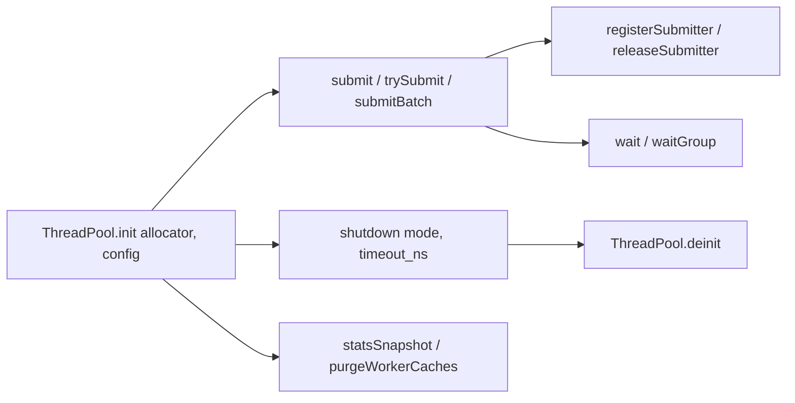
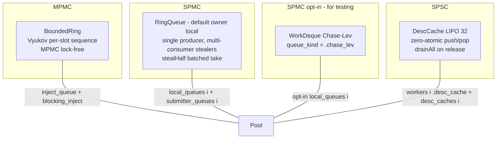
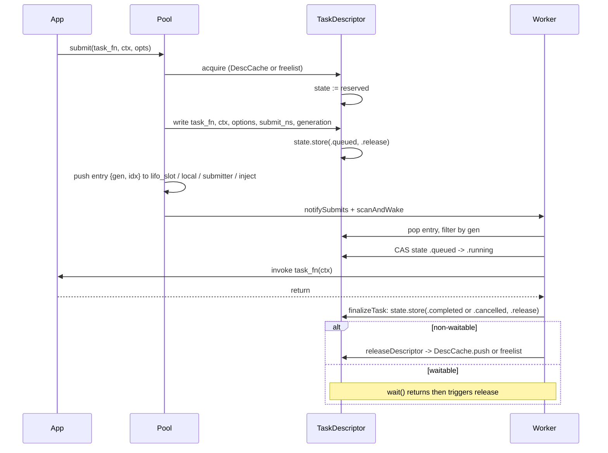

# thread-pool Design

## Overview

`thread-pool` is a fixed-capacity, shared-infrastructure thread-pool
with three concrete scheduler variants behind one public API:

- `global_queue`
- `work_stealing`
- `lane_extension`

The public API stays stable while scheduler selection, queue topology,
and instrumentation remain internal. Algorithm-level diagrams
(submit pipeline, worker loop, descriptor state, DescCache, wake
coalescing, lane routing, shutdown) are consolidated in
[ALGORITHMS.md](ALGORITHMS.md); this document covers rationale,
contracts, and memory / shutdown model.

## Public Surface

`ThreadPool.purgeWorkerCaches()` is quiescent-only. It returns
`error.PoolBusy` unless `active_tasks == 0 && queued_tasks == 0`.

## Scheduler Variants

### `global_queue`

- One bounded FIFO inject queue (`BoundedRing` MPMC).
- Fixed worker set.
- Workers pop directly from the shared queue.
- Included as the simplest correctness-first baseline and fallback.
- Submit-path bypasses LIFO slot and local queues entirely (comptime
  elided when `-Dscheduler-variant=global_queue`).

### `work_stealing`

- One bounded central inject queue for external submitters.
- One owner-local LIFO slot (`atomic u64` with `LIFO_SLOT_EMPTY`
  sentinel) plus one bounded local queue per worker.
- Local submissions from worker threads prefer the LIFO slot, then the
  local queue.
- Idle workers refill from the inject queue, then attempt steals from
  peer local queues using the `workers_nonempty` u64 bitmap to skip
  empty victims.
- Optional per-submitter SPMC queues via `registerSubmitter()` —
  cross-thread steal from submitter-owned push queues without paying
  MPMC inject contention.
- Worker wake selection:
  - `scan_parked_workers` (default) — rotating probe starting at
    `submitted % scan_len`.
  - `idle_queue` — bounded idle-worker ticket queue, opt-in.

### `lane_extension`

- `work_stealing` plus a dedicated blocking inject queue
  (`blocking_inject`) and a reserved worker range.
- Workers `[0, blocking_workers)` drain `blocking_inject`; workers
  `[blocking_workers, max_threads)` drain the default lane.
- Slice L3 cross-lane rebalance: a blocking worker always helps the
  default lane when its own lane is empty; a default worker helps the
  blocking lane only when `Config.cpu_helps_blocking` is set.
- Slice L4 watchdog: spawns up to `Config.max_overflow_workers` when
  a default-lane task runs longer than
  `blocking_promotion_timeout_ns`. Overflow workers retire
  themselves after sustained idleness.

## Queue Design

### Inject Queue

- Bounded ring buffer — `BoundedRing`.
- Vyukov-style per-slot `sequence` word encodes producer/consumer turn.
- Backpressure explicit: `error.QueueFull`, block with timeout, or
  block indefinitely.
- `popMany` fast path: one strong head CAS reserves up to
  `inject_batch_size` (default 32) entries, slot reads bounded by
  per-slot sequence spin.

### Local Worker Queue

- Bounded owner-local queue with pluggable implementation via
  `Config.queue_kind`.
- `queue_kind = .ring` — default SPMC modelled on Tokio/Go runq.
- `queue_kind = .chase_lev` — classic Chase-Lev deque.
- Owner pushes and pops from bottom/tail; stealers take from
  head/top.

### DescCache

- 32-entry SPSC LIFO per submitter slot (`desc_caches[i]`) and per
  worker (`workers[i].desc_cache`).
- Refill: `acquireDescriptorBatch` takes up to 32 indices from the
  global freelist with one acquire pointer exchange; cache holds
  tail, returns head to caller.
- Drain-on-release: `releaseDescriptor` pushes into the owning slot's
  cache; on overflow, bounded spin-retry onto the inject queue's
  freelist sibling.
- Drain-on-deinit: every cache is drained into the freelist before
  `deinit` frees the array; preserves `task_desc_live == 0` invariant.

## Memory Model

- Task descriptors are preallocated from a bounded descriptor array.
- Descriptor reuse happens only after task completion and, for
  waitable tasks, after `wait`.
- Worker scratch allocates one bounded buffer per worker lazily on
  first use.
- On the normal owning-worker path, scratch begin/alloc/finish are
  lock-free.
- Scratch buffers can be purged explicitly or after configured idle
  periods.
- Explicit purge is only legal while the pool is quiescent.
- All pool-owned allocations are counted in `total_alloc_bytes`,
  `total_free_bytes`, `live_bytes`, `peak_live_bytes`.

## Runtime Presets

- `RuntimePreset.standard` preserves the stable defaults.
- `RuntimePreset.tokio_parity` is an explicit benchmark-focused preset
  that currently enables:
  - `timestamp_mode = .disabled`
  - `wake_strategy = .idle_queue`

The preset exists as an opt-in configuration surface. It is not
silently forced by the benchmark harness.

## Task Lifecycle

1. Submission validates pool state and acquires a descriptor from the
   DescCache / bounded freelist.
2. The descriptor is enqueued either to the caller worker's LIFO slot,
   the caller worker's local deque, a submitter queue, or the central
   inject queue.
3. A worker dequeues, steals, or refills and transitions the
   descriptor to `running` via CAS.
4. The task executes exactly once.
5. The descriptor transitions to `completed` or `cancelled`.
6. Detached descriptors return to the DescCache / freelist immediately;
   waitable descriptors return after `wait`.

### Task panic behaviour (REV-001)

`task_fn` **must not panic**. Zig panics are non-catchable by design —
an integer overflow, OOB access, `@panic`, or `unreachable` in user
code aborts the entire process. This is the correct outcome for a
production pool: a panicked task leaves `counters.active_tasks`
incremented, `descriptor.claimed_by` set, and the matching
`WaitGroup.pending` undecremented. `Core.runTask` cannot recover
because the control flow never returns.

Callers that install a process-wide custom panic handler (e.g. a
debugger hook or a crash reporter) must not resume execution into the
pool after catching a panic. If they do, the pool cannot self-heal;
the only observable signal is
`Stats.accounting_skew_detected = true` across multiple consecutive
snapshots. See `docs/security/REV-001.md` for the ADR and
`src/pool.zig::runTask` for the contract comment.

### Descriptor reuse and idempotent `wait()` (SEC-018)

`releaseDescriptor` is CAS-guarded on `descriptor.state` so concurrent
`wait()` callers on the same handle cannot double-push the slot onto
the freelist. Exactly one caller performs the release; others observe
the state already `.free` (with a matching generation) and return
success. A late `wait()` on a reused slot returns
`error.InvalidHandle` via the generation-tag mismatch.

### Gen-tagged queue entries

Queue entries carry `{u32 gen, u32 idx}` packed into a `u64`. On every
release, the descriptor's `generation` increments. `runTask` rejects
any entry whose embedded gen does not match the descriptor's current
gen — closes the recycled-slot double-dispatch race.

Before gen tags, the double-dequeue race fuzz gate hit 9/20; post-gen
tags it's 20/20.

## Shutdown Semantics

```mermaid
flowchart LR
    Start[shutdown mode, timeout] --> Flag[state := shutting_down]
    Flag --> M{mode?}
    M -- drain --> Wait[Wait queued_tasks + active_tasks == 0]
    M -- cancel_pending --> Cancel[cancelQueuedTasks]
    Cancel --> Wait
    Wait --> WD[watchdog_stop := true]
    WD --> Broadcast[Broadcast park_cond all workers]
    Broadcast --> Join[Join worker threads]
    Join --> DrainCaches[Drain DescCaches to freelist]
    DrainCaches --> DrainSubs[Drain submitter_queues + desc_caches]
    DrainSubs --> Verify[Assert task_desc_live == 0]
    Verify --> Free[Free owned allocations]
```

### `drain`

- Reject new submissions.
- Let queued and running work finish.
- Join workers.
- Purge worker scratch.
- Release owned memory.

### `cancel_pending`

- Reject new submissions.
- Cancel tasks still in queues (`state.cmpxchgStrong(.queued, .cancelled)`).
- Running tasks continue to completion.
- Join workers and release resources.

## Fairness and Tradeoffs

- `global_queue` is simpler and sometimes slightly smaller in RSS
  because it lacks per-worker queue state.
- `work_stealing` reduces multi-producer contention and improves local
  handoff, but it is not currently lock-free (it is lock-free on the
  fast paths but not on the wake scan).
- Recursive submission is safe because worker-originated tasks
  preferentially target the caller's local LIFO slot.
- Blocking tasks are supported through lane metadata and
  `lane_extension`'s dedicated workers + overflow spawn.

## Performance-Relevant Design Choices

| Choice | Rationale | Where |
|---|---|---|
| 64-worker cap | `workers_nonempty` is a single `u64` | `Core.workers` |
| 64-submitter cap | `submitter_free_mask` is a single `u64` | `registerSubmitter` |
| Power-of-two queue sizes | mask instead of modulo | `BoundedRing`, `RingQueue`, `WorkDeque` |
| LIFO slot sentinel `0xFFFF_FFFF_FFFF_FFFF` | Gen-tagged entries never collide | `LIFO_SLOT_EMPTY` |
| `wake_coalesce_batch = 32` default | Amortises scan + futex cost | `notifySubmits` |
| `inject_batch_size` (32 default) | `popMany` amortises head-CAS | `tryDrainLaneForWorker` |
| `steal_batch_size` (16 default) | `stealHalf` copies rounded-up half | `nextTask` |
| End-of-struct `Worker.desc_cache` | Iter-11 showed layout-shift costs | `src/pool.zig::Worker` |

## Observability

`statsSnapshot()` reports:

- task lifecycle counters
- queue depth current and peak (per lane)
- steal and steal-failure counts
- wakeups and parks (aggregate + per worker)
- per-worker busy / idle / scratch / local-queue metrics
- wait and execution latency summaries (when `timestamp_mode = .full`)
- wake-latency histogram per worker
- watchdog stall counter + overflow spawn/retire counters
- Linux / macOS / Windows process memory metrics

## Comptime Elision Hooks

Three `-D` flags allow specialisation that drops branches at compile
time:

- `-Dsingle-pool=true` — elide per-pool TLS identity check
  (**UNSAFE** with >1 pool per process).
- `-Dtimestamp-mode=<m>` — pin `Config.timestamp_mode` to
  `disabled`/`completion_only`/`full`; drops histogram writes.
- `-Dscheduler-variant=<v>` — pin `Config.scheduler_variant`; drops
  alternative scheduler's branches from the hot path.

See [ALGORITHMS.md § Comptime Elision Hooks](ALGORITHMS.md#comptime-elision-hooks)
for the full map and measured gains.

## Known Gaps

- Adaptive grow/shrink is intentionally not implemented in phase 1.
  The L4b `max_overflow_workers` elastic spawn is watchdog-driven, not
  hysteresis-based.
- Per-task allocator-count metrics are not yet separate from byte
  accounting.
- Non-x86 platforms have not been benchmarked end-to-end; the queue
  primitives use `std.atomic.Value` so correctness is portable but
  tuning constants are empirical for x86_64.

## Further Reading

- [ALGORITHMS.md](ALGORITHMS.md) — mermaid diagrams for every pipeline
- [architecture.md](architecture.md) — component + ownership map
- [BENCHMARKS.md](BENCHMARKS.md) — measurement protocol + current numbers
- [PERFORMANCE_TRACKING.md](PERFORMANCE_TRACKING.md) — phase-by-phase deltas
- [SCHEDULER_DECISION.md](SCHEDULER_DECISION.md) — variant-picking rubric
