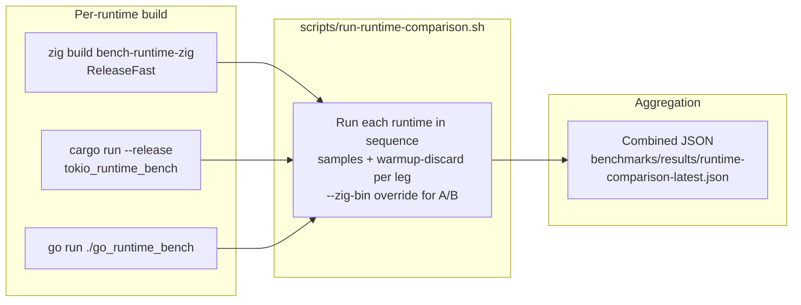
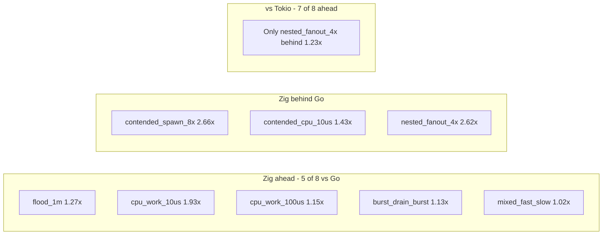

# Direct Runtime Comparison

Side-by-side benchmarks of this Zig thread pool, Tokio, and Go on the
same host using identical scenario contracts. All three runtimes are
built from vendored source trees (`third_party/tokio`, `third_party/go`).

## Pipeline



The combined JSON is directly diffable by `zig build compare-bench`.

## Current Snapshot

Run date: **2026-04-17**
HEAD: `2c99e2b` (code-identical to `a666ec3`, Go-gap round 1 FINAL)
Host: Linux x86_64, 56 workers, 2-socket / 1-NUMA-node.
Samples: 6 retained after 1 warmup discard.
Raw artefact: `benchmarks/results/runtime-comparison-latest.json`.

### Throughput (ops/sec, median of 6 samples)

| Scenario | Zig thread-pool | Tokio | Go | Zig vs Go | Zig vs Tokio |
|---|---:|---:|---:|---:|---:|
| `flood_1m` | 860,073 | 343,795 | 679,626 | **1.27x ahead** | **2.50x ahead** |
| `contended_spawn_8x` | 1,141,570 | 607,149 | 3,042,676 | 2.66x behind | **1.88x ahead** |
| `cpu_work_10us` | 1,070,750 | 449,018 | 554,179 | **1.93x ahead** | **2.38x ahead** |
| `cpu_work_100us` | 480,783 | 309,121 | 416,573 | **1.15x ahead** | **1.56x ahead** |
| `contended_cpu_10us` | 1,244,836 | 621,083 | 1,783,701 | 1.43x behind | **2.00x ahead** |
| `nested_fanout_4x` | 1,127,801 | 1,392,766 | 2,954,402 | 2.62x behind | 1.23x behind |
| `burst_drain_burst` | 160,994 | 142,510 | 141,912 | **1.13x ahead** | **1.13x ahead** |
| `mixed_fast_slow` | 258,541 | 231,506 | 252,541 | **1.02x ahead** | **1.12x ahead** |

### Completion Latency (p50 / p95 / p99, µs)

| Scenario | Zig | Tokio | Go |
|---|---|---|---|
| `cpu_work_10us` | 38 / 195 / 283 | 21 / 59 / 247 | 37 / 135 / 302 |
| `cpu_work_100us` | 1904 / 3422 / 3564 | 3002 / 4739 / 4828 | 1617 / 2078 / 2405 |
| `contended_cpu_10us` | 148 / 434 / 507 | 41 / 520 / 595 | 27 / 422 / 558 |
| `nested_fanout_4x` | 24 / 159 / 754 | 5 / 17 / 102 | 6 / 73 / 172 |
| `burst_drain_burst` | 643 / 1484 / 1654 | 1117 / 1871 / 2002 | 733 / 1079 / 2186 |
| `mixed_fast_slow` | 8793 / 15955 / 16942 | 7471 / 15115 / 18783 | 6106 / 9826 / 10614 |

## Scenario Matrix

| Scenario | Tasks | Submitters | Task Body |
|---|---:|---:|---|
| `flood_1m` | 1,000,000 | 1 | noop (atomic increment) |
| `contended_spawn_8x` | 100,000 | 8 | noop (atomic increment) |
| `cpu_work_10us` | 10,000 | 1 | 10 µs busy loop |
| `cpu_work_100us` | 2,000 | 1 | 100 µs busy loop |
| `contended_cpu_10us` | 10,000 | 4 | 10 µs busy loop |
| `nested_fanout_4x` | 10,000 | 1 | parent spawns 4 children (2K parents + 8K children) |
| `burst_drain_burst` | 4,000 | 1 | 50 µs busy loop, 10 ms idle gap between halves |
| `mixed_fast_slow` | 5,000 | 1 | 80% noop, 20% 1 ms busy loop |

All realistic scenarios use busy loops (not `sleep`) so the comparison
measures scheduling overhead under actual CPU work, not timer efficiency.

## Results Heatmap



## Analysis

### Where Zig wins (5 of 8 vs Go, 7 of 8 vs Tokio)

- **`cpu_work_10us` 1.93x ahead of Go.** Once tasks actually occupy CPU,
  the work-stealing deque + LIFO slot dispatch faster than Go's
  goroutine scheduler. Tokio is slower still because its submit path
  pays the future-wrap cost.
- **`flood_1m` 1.27x ahead of Go, 2.50x ahead of Tokio.** Wake
  coalescing + Vyukov MPMC inject + `popMany` drain let the pool
  sustain high submit throughput with single-producer bursts.
- **`cpu_work_100us` 1.15x ahead, p95 3422 µs vs Tokio 4739 µs.** Tokio
  cooperative yielding interacts poorly with 100 µs busy loops;
  Zig's preemption-free dispatch wins here.
- **`burst_drain_burst` 1.13x ahead on throughput + lowest p50 (643 µs).**
  The park + wake-from-idle protocol recovers cleanly across idle gaps;
  Tokio p50 is 1117 µs, Go p50 is 733 µs.
- **`mixed_fast_slow` 1.02x ahead.** Lane routing + rebalance keep
  short tasks moving even when 20% of the mix is 1 ms busy loops.

### Where Go wins (structural)

- **`contended_spawn_8x` (2.66x), `contended_cpu_10us` (1.43x).** Goroutine
  submitters run inside the Go runtime scheduler, using the local P
  queue with zero cross-thread cost. Any external thread pool pays an
  architectural tax on contended external submission. The Go-gap round
  2 plan attempted to close this via batched submit and LIFO rotate;
  both attacks failed the kill gate and reverted — see
  [2026-04-17 round 2 FINAL](performance/2026-04-17-go-gap-round2/FINAL.md).
- **`nested_fanout_4x` (2.62x behind Go).** `go func()` from inside a
  goroutine places the child on the local run queue at ~zero cost.
  Our pool lifts this onto the worker's LIFO slot via the DescCache
  fast path, closing the prior 6.01x gap to 2.62x, but Go's fiber-
  stack amortisation remains an architectural advantage.

### Latency Highlights

- **Zig best p50 on `burst_drain_burst` (643 µs vs Tokio 1117 µs).** Wake
  recovery is the fastest of the three runtimes despite similar
  throughput.
- **Zig best p95/p99 on `cpu_work_100us`** (3422 / 3564 µs vs Tokio
  4739 / 4828 µs). Go is still best on p50 (1617 µs) but has higher
  p99 than Zig.
- **`contended_cpu_10us` p50 Zig 148 µs, Tokio 41 µs, Go 27 µs.** Zig
  is highest on p50 here but lowest p95 still 434 µs vs Tokio 520 µs.

## Host Variance Caveat

Go's absolute throughput drifts 30–75% between thermal cycles on this
host. Cross-snapshot multipliers (Zig vs Go) therefore mix real Zig
deltas with Go's drift. **Read multipliers within a single snapshot;
read Zig deltas from the same-session paired A/Bs** in
`docs/performance/*/FINAL.md`.

Example: `contended_cpu_10us` "widened" 2.27x → 2.43x behind Go between
two snapshots despite a +25.93% Zig improvement, because Go moved
2.43M → 2.57M → 1.78M ops/sec across three consecutive sweeps.

## How To Re-Run

```bash
# Combined binary (Zig + Tokio + Go, one JSON artefact)
git submodule update --init --recursive
zig build bench-runtime-compare -Doptimize=ReleaseFast -- \
  --output benchmarks/results/runtime-comparison-latest.json

# Per-runtime binaries for scripted A/B loops
zig build bench-runtime-zig -Doptimize=ReleaseFast -- \
  --output results/zig.json --samples 7 --warmup-discard 1
cargo run --release \
  --manifest-path benchmarks/external/tokio_runtime_bench/Cargo.toml -- \
  --output results/tokio.json --samples 7 --warmup-discard 1
cd benchmarks/external/go_runtime_bench && \
  go run . --output ../../../results/go.json --samples 7 --warmup-discard 1

# Zig-only realistic suite (includes lane isolation)
zig build bench-realistic -Doptimize=ReleaseFast
```

## Related

- [BENCHMARKS.md](BENCHMARKS.md) — scenario matrix, A/B protocol, full
  methodology
- [ALGORITHMS.md](ALGORITHMS.md) — hot-path diagrams referenced in the
  analysis above
- [PERFORMANCE_TRACKING.md](PERFORMANCE_TRACKING.md) — per-phase deltas
- [2026-04-15 Runtime Comparison Archive](performance/2026-04-15-runtime-comparison/README.md)
- [2026-04-16 Go-gap contended (DescCache landing)](performance/2026-04-16-go-gap-contended/FINAL.md)
- [2026-04-17 Go-gap round 2 (FAILED)](performance/2026-04-17-go-gap-round2/FINAL.md)
- [2026-04-17 Go-gap round 3 (FAILED)](performance/2026-04-17-go-gap-round3/FINAL.md)
