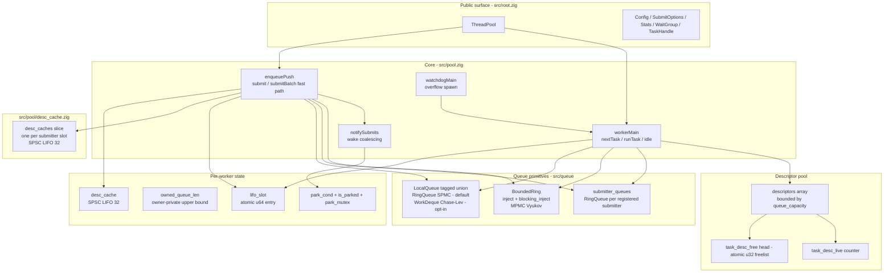
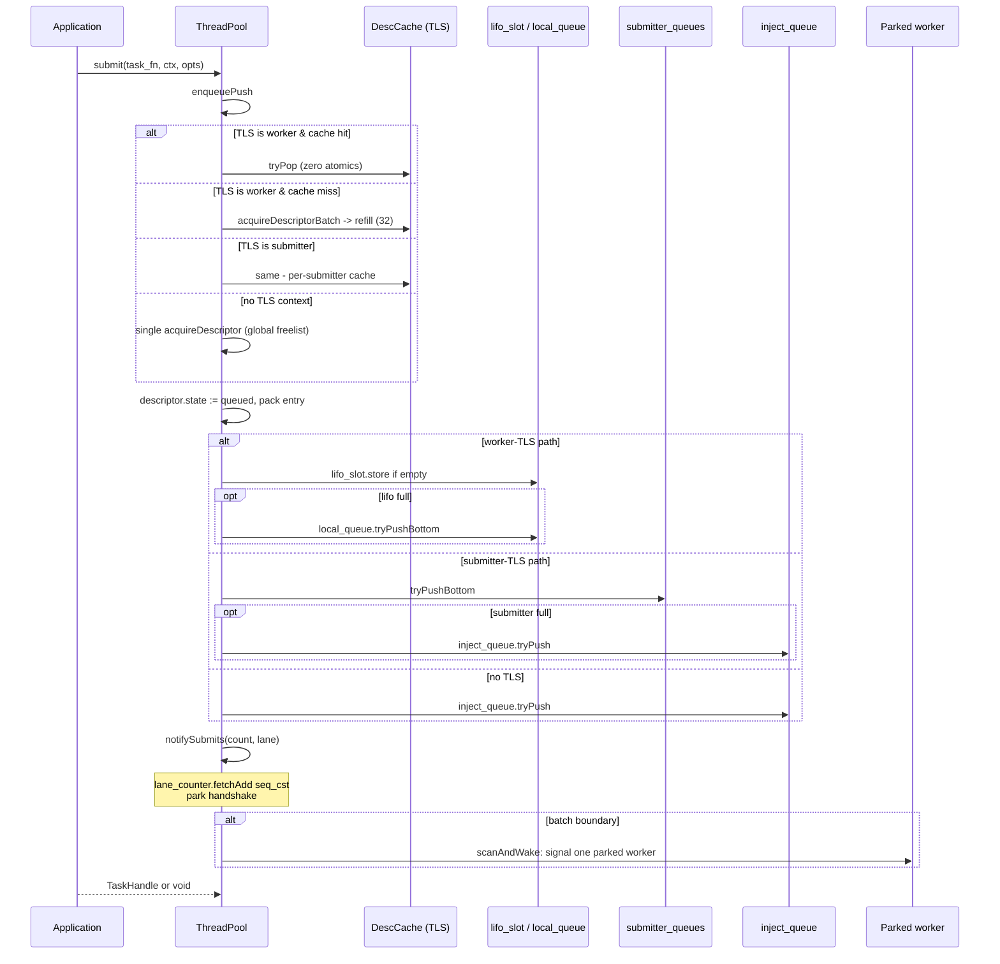
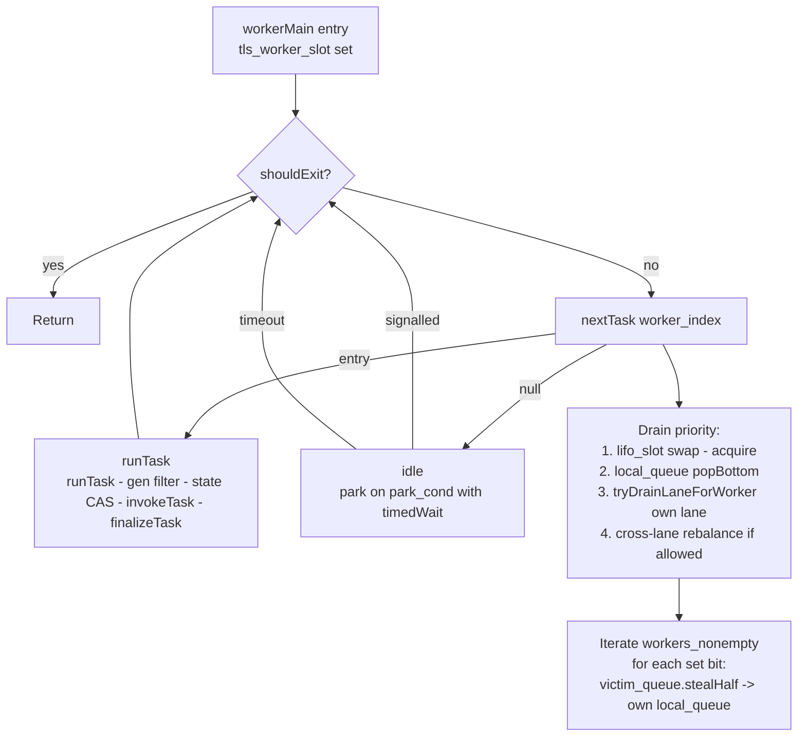
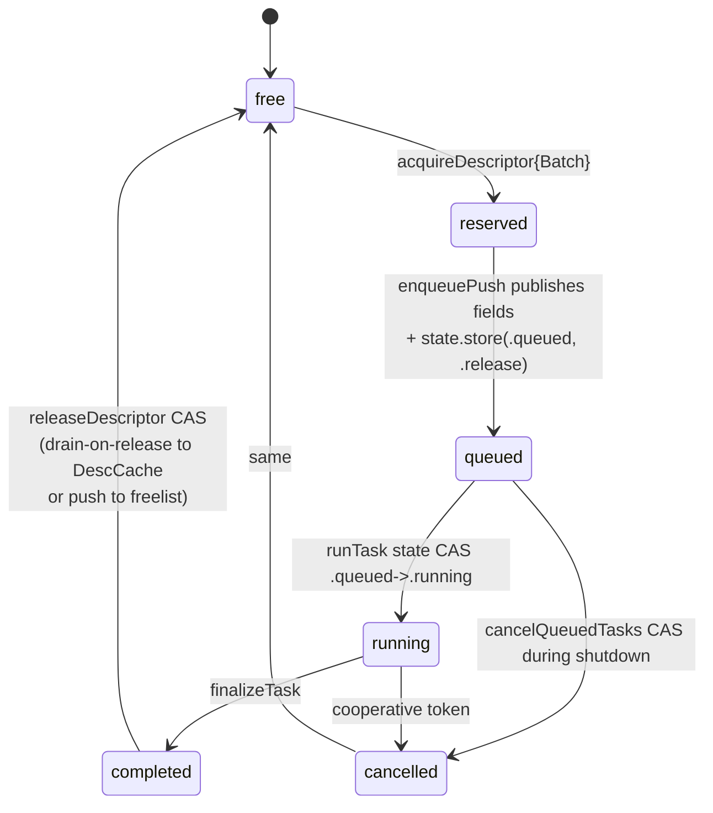
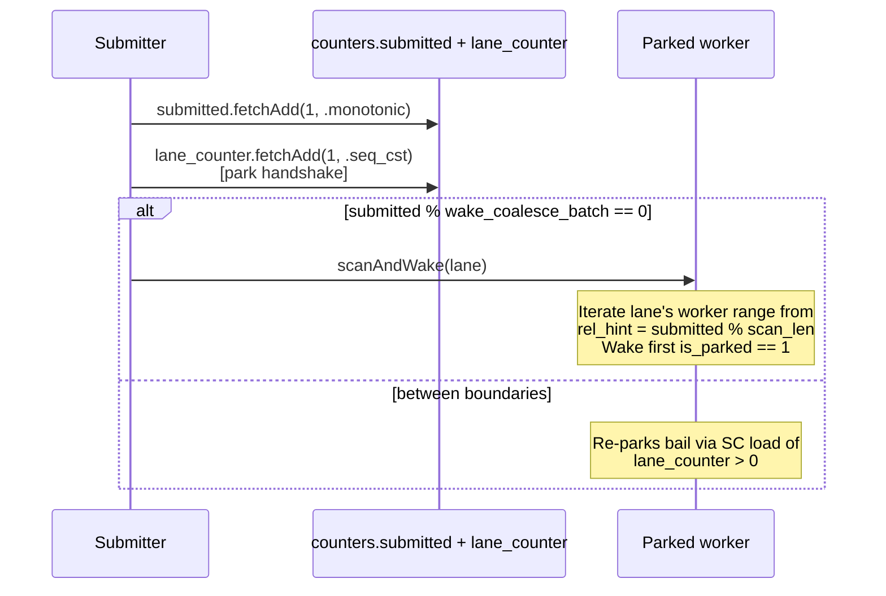
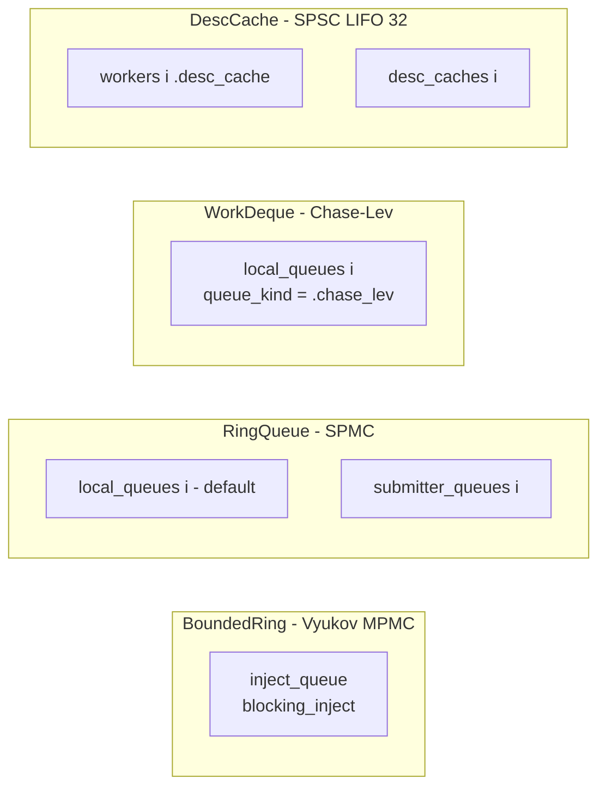

# Architecture

`thread-pool` is built around bounded task descriptors, a fixed worker
cap, and three scheduler variants behind one public API. This page
maps the components and ownership rules; deep algorithm details live
in [ALGORITHMS.md](ALGORITHMS.md).

## Component Map

## Ownership Rules

| Resource | Writers | Readers | Sync |
|---|---|---|---|
| `inject_queue` / `blocking_inject` | any | any worker | Vyukov MPMC seq + CAS |
| `local_queues[i]` | worker `i` (bottom) | any worker (top) | RingQueue/Chase-Lev protocol |
| `submitter_queues[i]` | submitter owning slot `i` | any worker | RingQueue SPMC protocol |
| `workers[i].lifo_slot` | worker `i` only | worker `i` only | single atomic swap/store |
| `workers[i].desc_cache` | worker `i` only | worker `i` only | no atomics — SPSC |
| `desc_caches[i]` | submitter owning slot `i` | submitter owning slot `i` | no atomics — SPSC |
| `workers_nonempty` u64 bitmap | worker `i` transitions 0↔1 | any (victim scan) | fetchOr / fetchAnd |
| `counters.*` | any | any | atomic monotonic / seq_cst |
| `tls_worker_slot` / `tls_submitter_slot` | the owning thread | the owning thread | thread-local |

## Lifetimes

- **Pool** owns every allocation reported by `statsSnapshot()`:
  `inject_queue` buffer, per-worker scratch buffers, local queues,
  submitter queues, descriptor array, DescCaches.
- **Worker threads** spawn during `init`; join during `shutdown`.
- **Overflow workers** spawn lazily via the watchdog and retire after
  `2 * watchdog_interval_ns` of idleness.
- **Descriptors** reuse only after `.completed` / `.cancelled` →
  `.free` transition. Waitable descriptors stay allocated until
  `wait()` returns.

## Task Submission Pipeline

Full diagram with the three scheduler variants and lane routing lives
in [ALGORITHMS.md § Top-Level Task Pipeline](ALGORITHMS.md#top-level-task-pipeline).

## Worker Scheduling Loop

Details:

- **LIFO slot first** makes worker-context submit → drain a cache-resident
  handoff.
- **`owned_queue_len` reconciliation:** if `popBottom` returns null but
  the owner counter was > 0, stealers drained the queue — reset to 0 and
  clear the bitmap bit.
- **Steal-half** copies up to `(len+1)/2` entries in one CAS; first entry
  is returned, rest spill into the worker's own local queue.
- **Cross-lane rebalance (L3):** blocking workers always help default;
  default workers help blocking only under `cpu_helps_blocking`.

## Descriptor Lifecycle

- **Gen tag:** `QueueEntry = {u32 gen, u32 idx}`; `runTask` filters
  recycled-slot entries via `entry_gen == descriptor.generation`.
- **Exactly-once dispatch:** `state.cmpxchgStrong(.queued, .running)` is
  the single serialization point.
- **Idempotent release (SEC-018):** concurrent `wait()` calls can't
  double-push; the CAS on `state` ensures exactly one release path.
- **Panic contract (REV-001):** `task_fn` must not panic; non-catchable
  by design.

## Wake Coalescing + Parked-Worker Scan

- **Wake one per batch.** Wake-up-to-`count` variants regress
  `flood_1m_batched ~50%` via thundering-herd on inject head.
- **Hint rotation** avoids consistently waking worker 0.

## Queue Primitives

See [ALGORITHMS.md](ALGORITHMS.md) for full correctness sketches + CAS
protocol diagrams for each.

## Observability

`statsSnapshot()` returns a single read-consistent view:

- lifecycle counters (`submitted`, `started`, `completed`, `cancelled`)
- queue depth current + peak (per lane)
- steals / steal-failures / wakeups / parks (aggregate + per worker)
- wait and execution latency histograms (when `timestamp_mode == .full`)
- wake-latency histogram (per worker, OBSERVABILITY-PIVOT R-03)
- per-worker scratch + local-queue metrics
- process memory on Linux / macOS / Windows
- watchdog stall counter + overflow spawn/retire counters

## Resource Model

- Task descriptors: bounded by `Config.queue_capacity`.
- Per-worker local queue capacity: bounded by `Config.local_queue_capacity`
  (power-of-two, max `65536`).
- Worker count: capped at `64` (bounded by `workers_nonempty` u64 bitmap).
- Submitter slots: capped at `64` (bounded by `submitter_free_mask` u64).
- Scratch: bounded by `worker_scratch_cap_bytes` per worker.
- `purgeWorkerCaches()` is quiescent-only
  (`active_tasks == 0 && queued_tasks == 0`), returns
  `error.PoolBusy` otherwise.

## Further Reading

- [ALGORITHMS.md](ALGORITHMS.md) — every pipeline + pseudocode
- [DESIGN.md](DESIGN.md) — rationale, API contract, memory model
- [SCHEDULER_DECISION.md](SCHEDULER_DECISION.md) — variant-picking rubric
- [PERFORMANCE_TRACKING.md](PERFORMANCE_TRACKING.md) — delta history
- [BENCHMARKS.md](BENCHMARKS.md) — scenario matrix + measurement protocol
